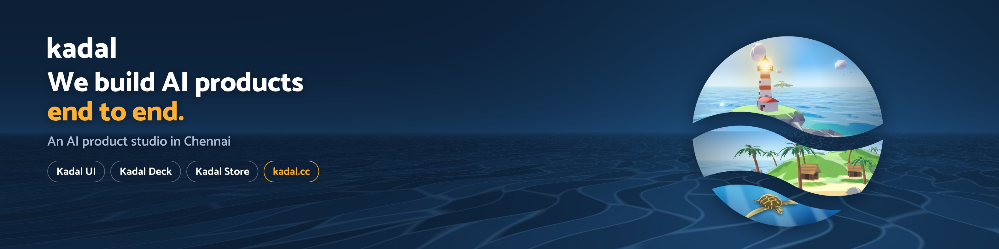
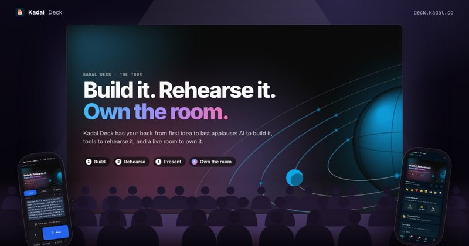
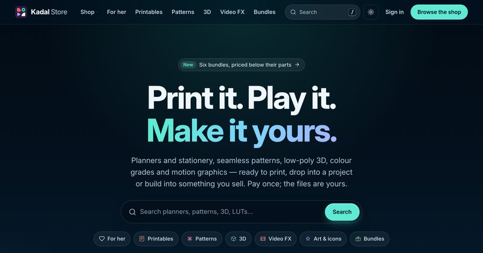
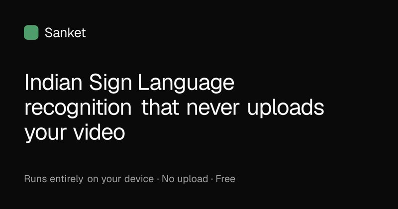
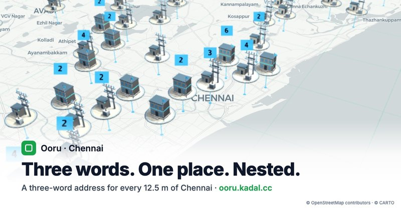
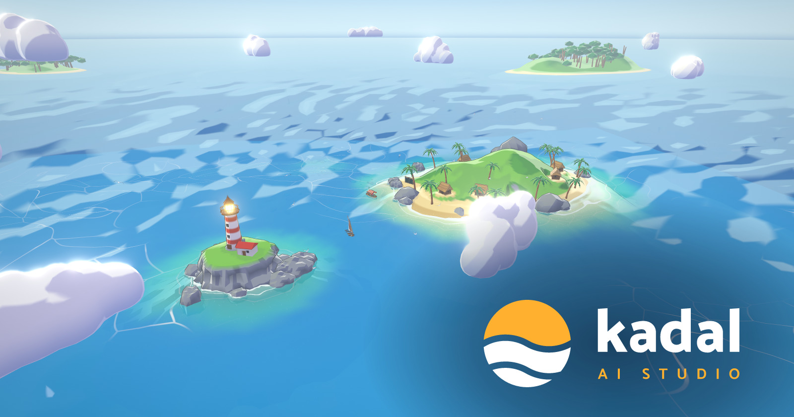
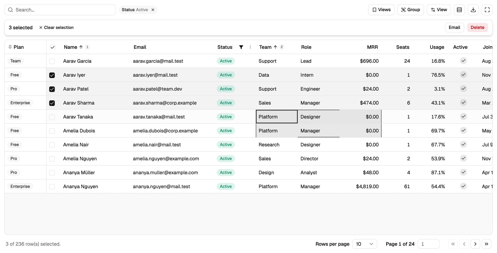
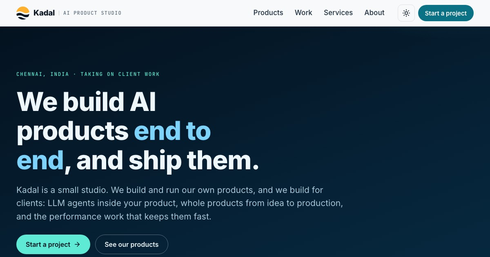
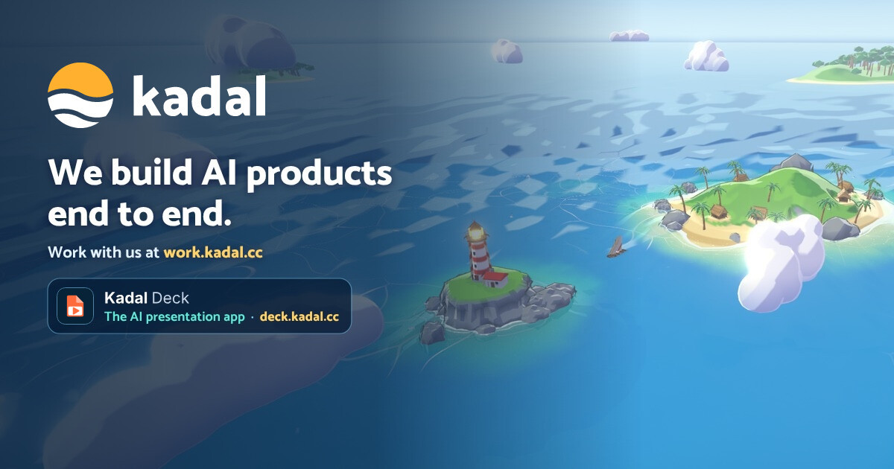

### Hi, we're Kadal 👋

An AI product studio in Chennai, India. We build AI products end to end: the model work, the platform under it, the UI on top. Then we ship them and keep them running.

- **Our products:** [Kadal Deck](https://deck.kadal.cc), the AI presentation app. Make slides with AI, rehearse them, and present them live while your audience joins from their phones. Launched on Product Hunt on 27 Oct 2026.
- **Our shop:** [Kadal Store](https://store.kadal.cc/?ref=github): printable planners and stationery, music and sound effects, WebGL shaders, seamless patterns, 3D and LUTs. Pay once, keep the files.
- **Open source:** [Kadal UI](https://ui.kadal.cc), React components for power users: a data grid on TanStack Table v9 and shadcn/ui that one command copies into your project ([kadalcc/ui](https://github.com/kadalcc/ui), MIT). The Deck engine is [kadalcc/deck](https://github.com/kadalcc/deck) (AGPL-3.0), on npm as [@kadal/deck](https://www.npmjs.com/package/@kadal/deck), with the desktop app on [Homebrew](https://github.com/kadalcc/homebrew-tap) and [Scoop](https://github.com/kadalcc/scoop-bucket).
- **Client work:** LLM agents inside your product, whole products from idea to production, and the performance work that keeps them fast. Start at [work.kadal.cc](https://work.kadal.cc).
- **Founded by:** [Mithunish Prabhakaran](https://github.com/pmithunish), AI product engineer ([pmithunish.com](https://pmithunish.com)).

### What we've built, live

<table>
  <tr>
    <td width="50%" valign="top">
      <a href="https://deck.kadal.cc"></a>
      <br><b><a href="https://deck.kadal.cc">Kadal Deck</a></b>: the AI presentation app. An AI assistant drafts the deck with you, narration and a teleprompter help you rehearse, your phone is the remote, and the audience joins a live room from their phones for polls, quizzes and Q&amp;A. Free for public decks.
      <br><sub>MDX · React · MCP · Durable Objects with hibernating WebSockets · open source (AGPL)</sub>
    </td>
    <td width="50%" valign="top">
      <a href="https://store.kadal.cc/?ref=github"></a>
      <br><b><a href="https://store.kadal.cc/?ref=github">Kadal Store</a></b>: printable planners and stationery, music loops and sound effects, WebGL shaders, seamless patterns, low-poly 3D and LUTs. Pay once and keep the files, with personal and commercial licences.
      <br><sub>Cloudflare Workers · Hono · D1 · R2 · Paddle</sub>
    </td>
  </tr>
  <tr>
    <td width="50%" valign="top">
      <a href="https://sanket.kadal.cc"></a>
      <br><b><a href="https://sanket.kadal.cc">Sanket</a></b>: Indian Sign Language recognition that runs fully offline in the browser. A 4.6 MB model at 12.5 ms per window over an 8,165-word vocabulary.
      <br><sub>MediaPipe · PyTorch · self-supervised JEPA · int8 ONNX · Web Workers</sub>
    </td>
    <td width="50%" valign="top">
      <a href="https://ooru.kadal.cc"></a>
      <br><b><a href="https://ooru.kadal.cc">Ooru</a></b>: a three-word address for every 12.5 m of Chennai, plus a <a href="https://ooru.kadal.cc/outages">citizen power-cut map</a> that resists abuse without logins.
      <br><sub>Next.js on Cloudflare Workers · D1 · deck.gl · MapLibre · Turnstile</sub>
    </td>
  </tr>
  <tr>
    <td colspan="2" valign="top">
      <a href="https://kadal.cc"></a>
      <br><b><a href="https://kadal.cc">kadal.cc</a></b>: our home, a scroll-dive through a toon sea where every product is an island. 54 procedurally generated Blender assets in ~1.3 MB.
      <br><sub>three.js · TypeScript · Blender CLI</sub>
    </td>
  </tr>
</table>

### Open source

<table>
  <tr>
    <td width="50%" valign="top">
      <a href="https://ui.kadal.cc"></a>
      <br><b><a href="https://ui.kadal.cc">Kadal UI</a></b>: Components you own. A power-user data grid for React, built on TanStack Table v9 and shadcn/ui. One command copies the source into your project. MIT.
      <br><sub>React · TanStack Table v9 · shadcn/ui · Base UI · TypeScript · open source (MIT)</sub>
    </td>
    <td width="50%" valign="top">
      <b>Install</b>
      <br><code>npx shadcn@latest add @kadal/data-grid</code>
      <br><br><b>Source and package</b>
      <br><a href="https://github.com/kadalcc/ui">kadalcc/ui</a> · <a href="https://www.npmjs.com/package/@kadal/ui">@kadal/ui</a> on npm, the CLI · <a href="https://ui.kadal.cc">ui.kadal.cc</a>, the docs
      <br><br><b>Free, MIT</b>
      <br>Open-source React components for power users. Use them in anything; if they earn their keep, <a href="https://github.com/sponsors/pmithunish">sponsor the work</a>.
    </td>
  </tr>
</table>

The Kadal Deck engine is open source too, the same one that runs [deck.kadal.cc](https://deck.kadal.cc): write a talk in MDX, rehearse it, present it with a live room, export it to PDF or PPTX.

```sh
npm create @kadal/deck@latest my-talk                # a new deck, from npm
brew install --cask kadalcc/tap/kadal-deck           # the desktop app on macOS
scoop bucket add kadal https://github.com/kadalcc/scoop-bucket
scoop install kadal/kadal-deck                       # the desktop app on Windows
```

| Repository | What it is |
| --- | --- |
| [kadalcc/ui](https://github.com/kadalcc/ui) | Kadal UI: the data grid, the shadcn registry it ships through, and the `@kadal/ui` CLI (MIT) |
| [kadalcc/deck](https://github.com/kadalcc/deck) | The engine, CLI, themes and MCP server for Kadal Deck (AGPL-3.0) |
| [kadalcc/homebrew-tap](https://github.com/kadalcc/homebrew-tap) | Homebrew cask for the desktop app and formula for the `kadal-deck` CLI |
| [kadalcc/scoop-bucket](https://github.com/kadalcc/scoop-bucket) | Scoop manifests for the desktop app and the CLI on Windows |

Questions, ideas and show-and-tell go in [Discussions](https://github.com/orgs/kadalcc/discussions); bugs go in the repo's issues.

### Work with us

<table>
  <tr>
    <td width="50%" valign="top">
      <a href="https://work.kadal.cc"></a>
    </td>
    <td width="50%" valign="top">
      <b>What we take on</b>
      <br>AI agent sprints · product builds · performance and reliability rescues · fractional senior engineering
      <br><br><b>What we're good at</b>
      <br>LLM agents and evals · machine learning in the browser · maps and GIS · real-time on WebSockets and Durable Objects · 3D on the web
      <br><br><b>How to start</b>
      <br>Tell us about the project at <a href="https://work.kadal.cc/contact/">work.kadal.cc/contact</a>. We reply within one working day.
    </td>
  </tr>
</table>

### How we work

AI-native: we run coding agents in parallel behind hard verification gates (typecheck, tests, real-browser checks), so a small studio ships at the pace of a bigger team without lowering the bar.

### Stack

TypeScript · React · Bun · Hono · Effect · Cloudflare (Workers, D1, Durable Objects, R2) · PostgreSQL · LLM APIs, agents & evals · MCP · PyTorch · ONNX · three.js

### Find us

<table>
  <tr>
    <td width="50%" valign="top">
      <a href="https://kadal.cc"></a>
      <br><b><a href="https://kadal.cc">kadal.cc</a></b>: our home on the web. Write to us at <a href="mailto:hello@kadal.cc">hello@kadal.cc</a>.
      <br><br><b>Office</b>: Chennai, India, by appointment. <a href="https://work.kadal.cc/contact/#office-h">Address and map</a>.
    </td>
    <td width="50%" valign="top">
      <b>Talk with us</b>
      <br><a href="https://discord.gg/pdWcSbxNKa">Discord</a> · <a href="https://github.com/orgs/kadalcc/discussions">Discussions</a> · <a href="https://t.me/kadalcc">Telegram</a>
      <br><br><b>Follow</b>
      <br><a href="https://x.com/kadalstudio">X</a> · <a href="https://www.linkedin.com/company/kadalcc/">LinkedIn</a> · <a href="https://bsky.app/profile/kadal.cc">Bluesky</a> · <a href="https://www.threads.com/@kadalstudio">Threads</a> · <a href="https://www.instagram.com/kadalstudio/">Instagram</a> · <a href="https://www.facebook.com/kadalcc">Facebook</a> · <a href="https://www.youtube.com/@kadalcc">YouTube</a> · <a href="https://www.pinterest.com/kadalcc/">Pinterest</a> · <a href="https://whatsapp.com/channel/0029VbE31xk1Hspu4KGxUR28">WhatsApp</a>
      <br><br><b>Shop</b>
      <br><a href="https://store.kadal.cc/?ref=github">Kadal Store</a>: planners, stationery, sounds and design assets
      <br><br><b>Read and build</b>
      <br><a href="https://dev.to/kadalcc">DEV</a> · <a href="https://www.npmjs.com/package/@kadal/deck">npm</a> · <a href="https://ui.kadal.cc">Kadal UI</a> · <a href="https://www.producthunt.com/products/kadal-deck">Product Hunt</a>
    </td>
  </tr>
</table>

<sub>Privacy and terms: <a href="https://kadal.cc/privacy">kadal.cc/privacy</a> · <a href="https://kadal.cc/terms">kadal.cc/terms</a></sub>
